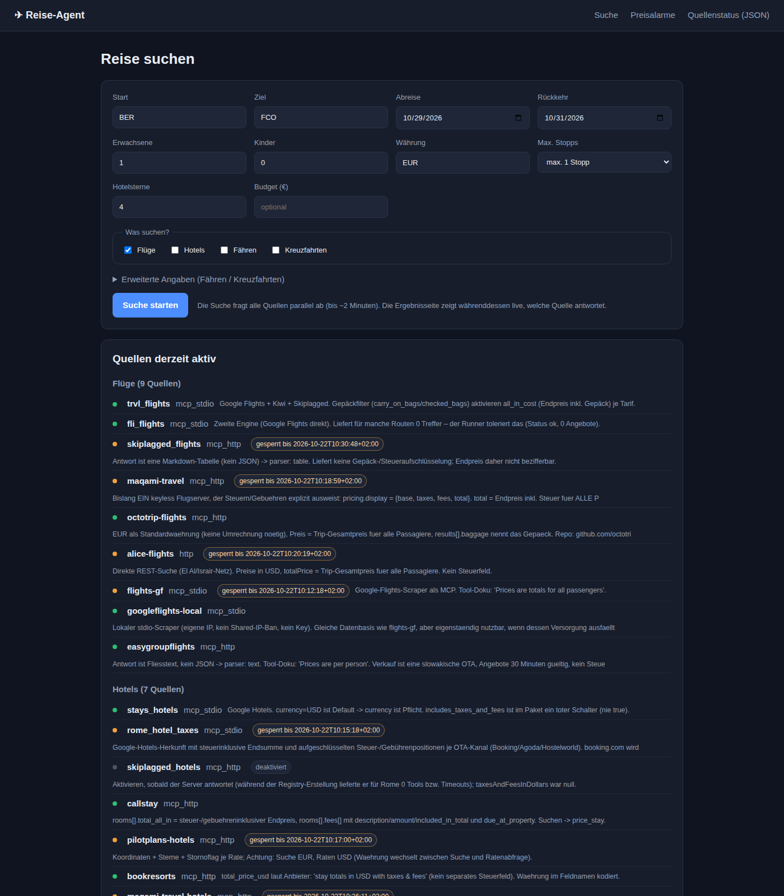
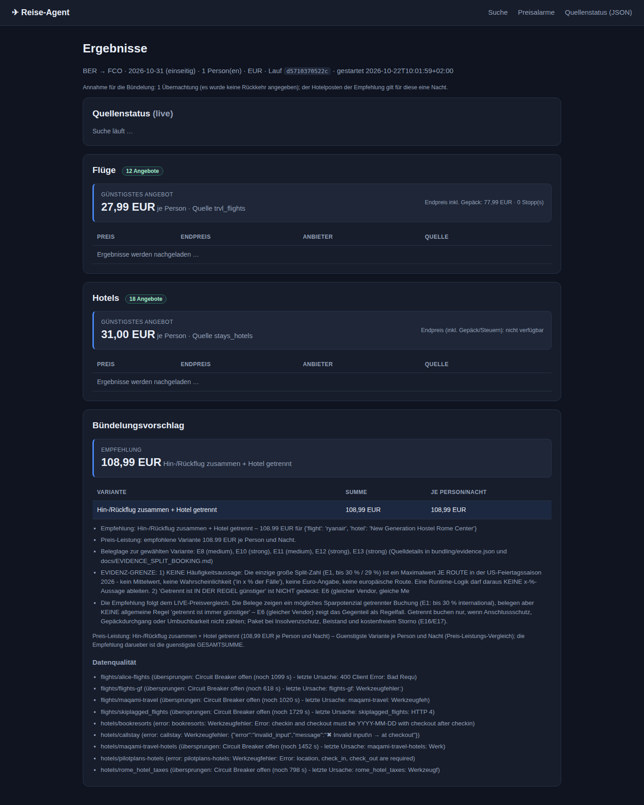
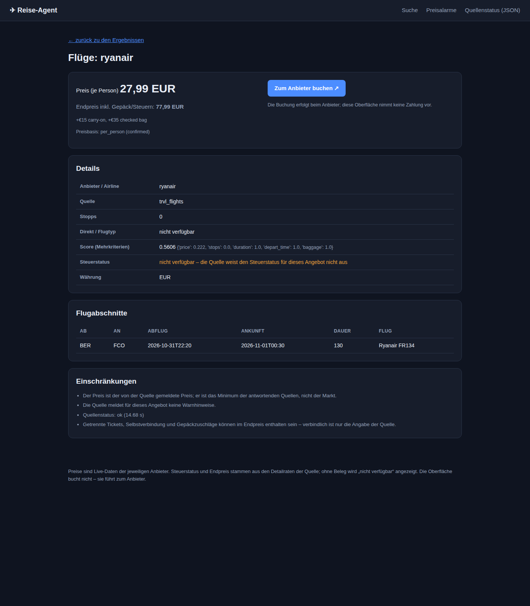
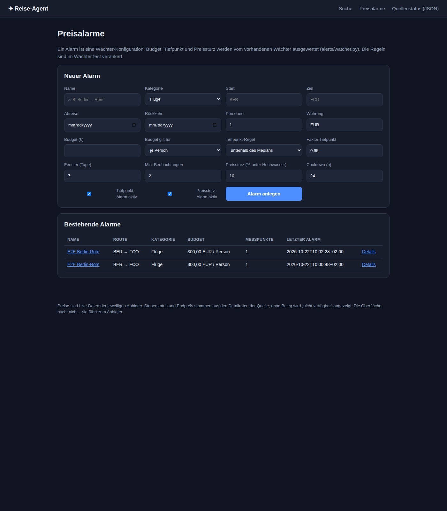

# Weboberfläche des Reise-Agent-Systems

Eine vollständige Oberfläche für das bestehende System: Suche, Bündelung, Detailansicht,
Preisalarme und Quellenstatus. **Es ist keine eigene Reiselogik enthalten** – die Oberfläche
ruft die vorhandenen Module auf und zeigt deren Ergebnisse an:

| Funktion | Aufruf an |
|---|---|
| Suche (Flüge, Hotels, Fähren, Kreuzfahrten) | `providers/runner.py` → `run()` |
| Bündelungsvorschlag (Paket vs. getrennt …) | `bundling/compare.py` → `compare()` |
| Preisalarm, Verlauf, Coverage | `alerts/watcher.py` (als Unterprozess mit `--once`) |
| Preise, Endpreise, Steuerstatus, Währung, Plausibilität, Quellenstatus | unverändert aus den Modulen oben |

## Start

```bash
cd /home/batnini/mimo-agents
bash ui/start.sh              # http://127.0.0.1:8077
bash ui/start.sh 9000         # anderer Port
```

oder direkt:

```bash
python3 -m uvicorn ui.app:app --host 127.0.0.1 --port 8077
```

Keine zusätzlichen Pakete nötig: FastAPI, Uvicorn und Jinja2 sind im System-Python vorhanden.

## Bedienung

1. **Suche** (`/`): Start, Ziel, Datum, Rückkehr, Personen, Währung, Stopps, Hotelsterne, Budget –
   dazu die Kategorien (Flüge/Hotels/Fähren/Kreuzfahrten) und optionale Angaben für Fähre/Kreuzfahrt.
   Das Feld *Zeitlimit je Quelle* begrenzt, wie lange eine einzelne Quelle laufen darf
   (Default: Registry-Wert 240 s).
2. **Ergebnisse** (`/jobs/<id>`): während der Suche live der Status jeder Quelle
   (antwortet / übersprungen / blockiert), danach je Kategorie das günstigste Angebot, die
   Top-Liste mit Detail-Link, der Bündelungsvorschlag samt Begründung und Evidenzgrenze sowie
   die Datenqualität (blockierte oder korrupte Quellen).
3. **Detail** (`/jobs/<id>/detail/<kategorie>/<nr>`): Preis, Endpreis inkl. Gepäck, Steuerstatus,
   Buchungslink, Flugabschnitte, Score/Gate, Warnhinweise und Einschränkungen.
4. **Preisalarme** (`/alarms`): Budget (je Person oder für die ganze Reise), Tiefpunkt-Regel
   (Median / Perzentil / Tiefpunkt im Fenster), Preissturz gegen die Hochwasser-Marke, Cooldown.
   Der Wächter läuft wahlweise sofort („Wächter jetzt einmal laufen lassen“).
5. **Quellenstatus** (`/api/status`): alle Quellen je Kategorie mit Sperrzeit und letzter Fehlerursache.

## Ortsauflösung (Städtenamen, Tippfehler, Kürzel)

Vor jeder Suche werden die Orte in die Codes der jeweiligen Kategorie übersetzt
(`resolver/`, Details in `resolver/ENTSCHEIDUNG.md`): Flüge → IATA, Hotels → Stadt +
Koordinaten, Fähren → Hafenname, Kreuzfahrten → Hafen-Code. Grundlage sind zwei lokale,
offline Datenbestände (OurAirports, UN/LOCODE) – kein Extra-Netzaufruf.

* Autocomplete im Formular (`/api/resolve/suggest`), Prüfung beim Verlassen (`/api/resolve`).
* Die Ergebnisseite zeigt „Toulouse → TLS“.
* Unbekannte Orte beenden die Kategorie **mit klarer Meldung**, ohne Quellen zu belasten.
* Ein Eingabefehler zählt **nicht** als Quellenausfall (Circuit Breaker).

Test: `python3 resolver/tests/test_resolver.py` und `python3 resolver/tests/e2e_places.py`.

## Ergebnisseite: stabiler Live-Bereich + Fortschritts-Animation

Die Seite springt nicht mehr: Alle Quellen werden **von Anfang an** mit Status „wartet“
gerendert (der Server legt die Liste **synchron beim Start** des Laufs an – vor dem Hintergrund-
Thread), der Live-Bereich hat eine **feste Höhe mit interner Scrollfläche** (240 px), und das
JavaScript aktualisiert die Zeilen **in place** statt die Tabelle neu zu schreiben. Fehlt eine
Zeile im HTML (weil die Seite extrem früh geladen wurde), legt das JS sie selbst an. Es gibt
**keinen Reload** mehr – Ergebnistabelle, Badge und Bündelung werden bei „fertig“ per JS nachgezogen.

Der Fortschritt wird als **Agenten-Netzwerk** dargestellt (SVG + CSS, keine Bibliothek):
* **Zentrum:** Knoten „Agent“ mit Zähler (z. B. 6/9); ein Ring pulsiert, solange die Suche läuft.
* **Quellen:** Knoten auf einer Ellipse, Farbe = Status (grau/grün/gelb/rot).
* **Verbindungen:** wartend = gestrichelt grau mit fließender Animation (`stroke-dashoffset`) und
  einem wandernden „Datenpaket“ (`offset-path`); ok = durchgezogen grün; Fehler = rot;
  übersprungen = gelb. Frisch beantwortete Quellen leuchten kurz auf.
* **Label** „6 von 9 Quellen geantwortet …“ → „Fertig – 9/9 Quellen“.
* `prefers-reduced-motion` schaltet alle Animationen ab.
* Recherche und Begründung: `ui/ANIMATION_ENTSCHEIDUNG.md`.

Tests:
* `python3 ui/tests/test_instant_page.py` – Seite **sofort** nach dem Absenden öffnen: Quellenzeilen
  sind da, Fortschritt zählt, am Ende Tabelle/Badge gefüllt (kein F5 nötig).
* `python3 ui/tests/test_live_stability.py` – Layout-Spanne 0 px, genau ein Seitenaufruf.
* `python3 ui/tests/test_agent_graph.py` – SVG-Graph, Knoten = Kanten, Fluss-Animation,
  Statuswechsel, Zentrum n/n, Graphhöhe konstant.

## End-to-End-Test

```bash
# Server starten, dann:
python3 ui/tests/e2e_test.py                    # HTTP-Fluss (35 Prüfungen)
python3 ui/tests/e2e_test.py http://127.0.0.1:9000
python3 ui/tests/test_reload.py                 # echter Browser (CDP): Reload + Tabellen
```

Der Test simuliert einen Nutzer: Formular absenden → Job verfolgen → Ergebnisseite prüfen →
Detailseite prüfen → Alarm anlegen → Wächter laufen lassen → Status abfragen.

## Suchmaschinen (SEO)

Die Oberfläche ist für Suchmaschinen vorbereitet (Details in `seo/ENTSCHEIDUNG.md`):

* **Indexierbare Seiten:** `/`, `/preisvergleich`, `/fluege`, `/hotels`, `/faehren`,
  `/kreuzfahrten` und – aus dem letzten Suchlauf – Routenseiten wie `/fluege/ber-fco`.
* **Nicht indexiert:** `/jobs/<id>` (nutzerspezifisch, `noindex`), `/alarms` (privat), `/api/*`.
  Wichtig: `/jobs/` steht **nicht** in der robots.txt – `Disallow` + `noindex` würde das
  `noindex` unwirksam machen.
* **`/sitemap.xml`** und **`/robots.txt`** werden dynamisch erzeugt (Basis-URL der Anfrage).
* **JSON-LD:** Breadcrumb, Organization, FAQ, auf Routenseiten zusätzlich ItemList/Offer und
  AggregateOffer aus genau den sichtbaren Preisen. **Kein** `AggregateRating` – wir haben keine
  echten Bewertungen.
* **Prüfen:** `python3 seo/validate.py --base http://127.0.0.1:8077` (Crawl-Simulation) und
  `python3 seo/tests/test_seo.py`.
* **Deployment:** `SITE_URL=https://deine-domain.tld` setzen – daraus entstehen kanonische URLs,
  Sitemap und robots.txt. Ohne die Variable wird die Basis-URL der Anfrage genutzt (nur für Dev).
  Danach `sitemap.xml` in der Google Search Console einreichen.

## Affiliate-Links und Kennzeichnung

Buchungslinks können Affiliate-Links sein. Die Oberfläche zeigt dann direkt am Link
**„Anzeige · Affiliate-Link“**, setzt `rel="sponsored"` und erklärt, dass der Preis gleich bleibt.
Ohne konfigurierte Partnerkennung (`affiliate/config.yaml`) bleibt der Link ungetaggt und die Seite
nennt den Grund. Details: `affiliate/ENTSCHEIDUNG.md` und `affiliate/README.md`.

## Was die Oberfläche bewusst nicht kann

* **Kein Bezahlen, kein Ticket.** Das System hat keine Buchungs-, Zahl- oder Reservierungsfunktion
  (es gibt keine Schnittstelle zu Airlines und keine Zahlvorgabe). Die Oberfläche führt deshalb zum
  Anbieter: der Button „Zum Anbieter buchen“ öffnet den `booking_url` der Quelle in einem neuen Tab.
  Nur `http(s)`-Links werden übernommen.
* **Keine eigene Preislogik.** Es gibt keine eigene „günstigste/preiswertigste“-Logik in der UI und
  keinen „teuersten“-Modus: Empfehlung ist die günstigste Variante, Budgetregeln gelten unverändert.
  Das Budget im Suchformular ist ein Hinweis (und der Wert für den Preisalarm), keine Auswahlregel.

## Screenshots

| | |
|---|---|
|  |  |
| Suchformular mit Kategorien und Quellenstatus | Ergebnisse: günstigstes Angebot je Kategorie, Bündelung, Datenqualität |
|  |  |
| Detailansicht mit Buchungslink, Steuerstatus, Einschränkungen | Preisalarme mit Budget/Tiefpunkt/Preissturz |

## Technik

* FastAPI + Jinja2 (serverseitiges HTML, kein Build-Schritt) + ein kleines Vanilla-JS für das Live-Polling.
* Suchläufe laufen als Hintergrundthread (`ui/service.py`), weil eine Suche über 22 Quellen 1–2 Minuten
  dauert; die Ergebnisseite pollt `/api/jobs/<id>` und zeigt den Fortschritt.
* `providers/runner.py` hat dafür einen optionalen Parameter `progress` bekommen (Callback je
  abgeschlossener Quelle). Ohne Callback verhält sich der Runner exakt wie vorher.
* Laufzeitdaten liegen unter `ui/state/` (Jobs, Alarm-Konfigurationen, Verläufe) und können gelöscht werden.

## Dateien

```
ui/
  app.py                 FastAPI-Routen
  service.py             Adapter auf runner/compare/watcher (die einzige Aufrufstelle)
  templates/             base, search, results, detail, alarms, alarm
  static/                app.css, app.js
  start.sh               Startskript
  tests/e2e_test.py      End-to-End-Test über HTTP
  state/                 Laufzeitdaten (Jobs, Alarme)
```
